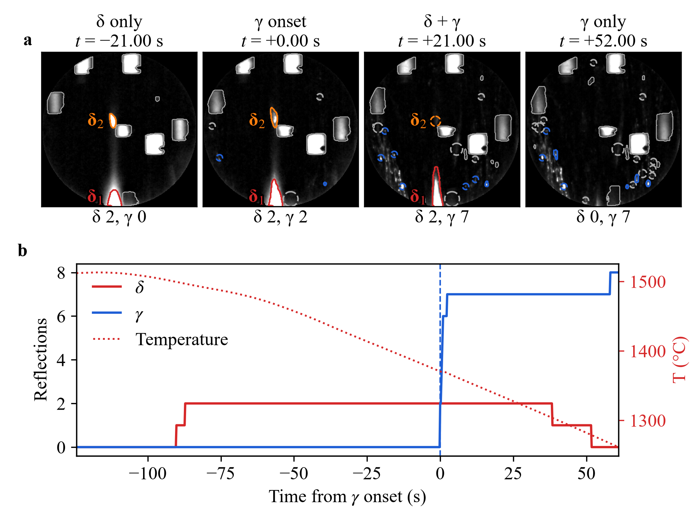
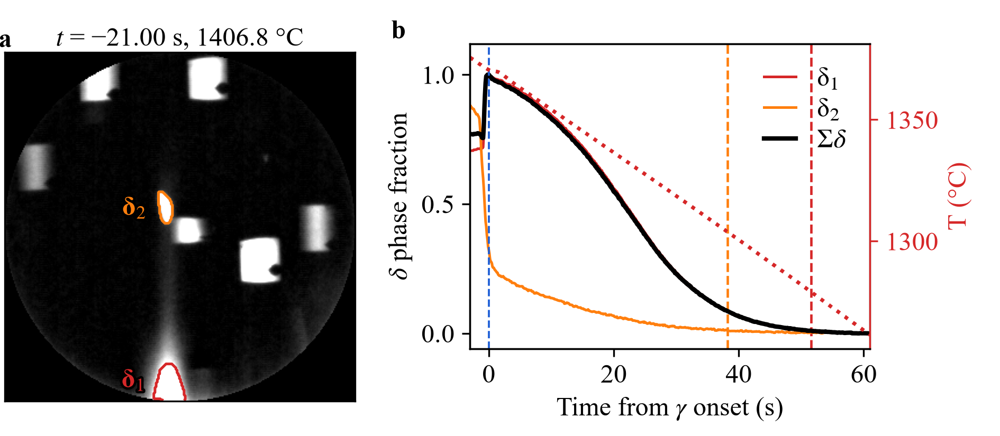
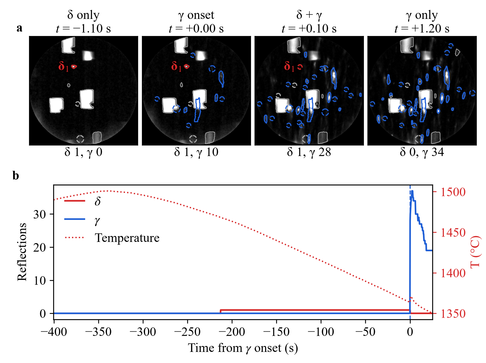
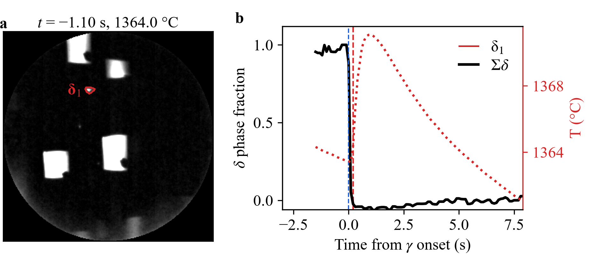
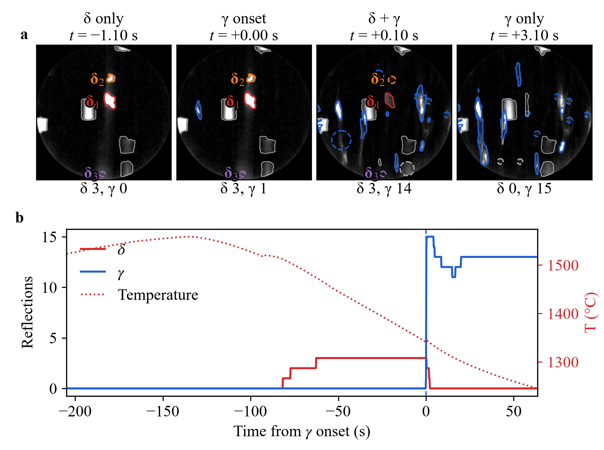
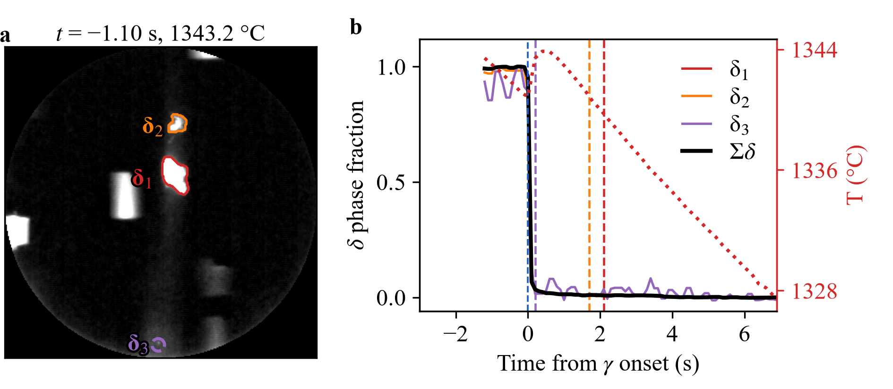
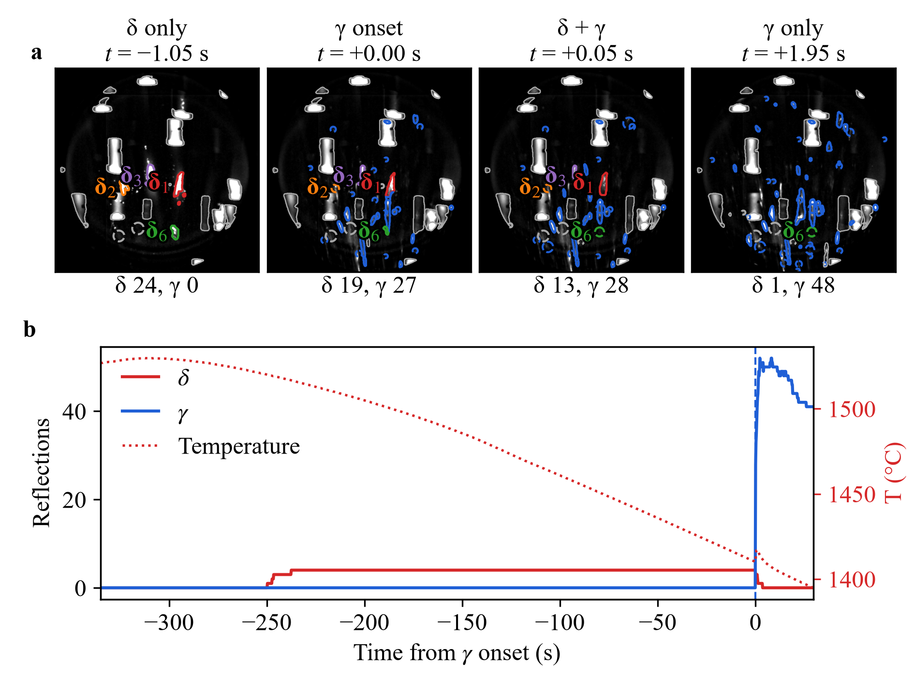
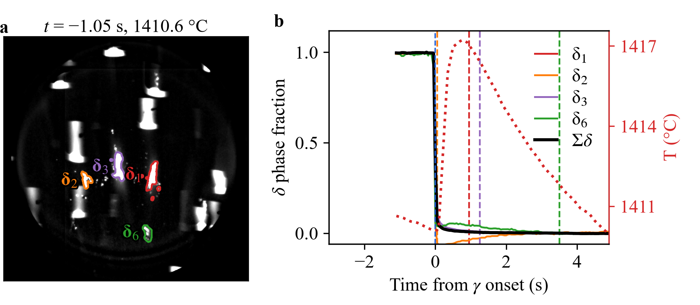

# Figures 3 and 4 for the other runs

The paper shows Figs. 3 and 4 for Steel C at 110 °C min⁻¹ (`26_V19_5A`). This folder has the same two figures for the other four runs. They were made with the same plotting code and the results in `results/`.

| Run | Steel, cooling rate | Fig. 3: phase labels | Fig. 4: multi-δ kinetics |
|---|---|---|---|
| `2_TRIP1` | TRIP T1, 110 °C min⁻¹ |  |  |
| `8_TRIP2` | TRIP T2, 30 °C min⁻¹ |  |  |
| `31_A003` | ULC, 132 °C min⁻¹ |  |  |
| `21_V19_1A` | Steel C, 30 °C min⁻¹ |  |  |

**Fig. 3, phase labels.** Times are measured from the γ onset t\* (blue dashed line).
- **a**, Labeled reflections in four Laue patterns: δ only, γ onset, δ + γ and γ only. Each δ has its own color, γ is blue and non-specimen signals are gray. A dashed circle marks a δ that SAM did not detect in that frame but that has not yet disappeared.
- **b**, Numbers of δ and γ reflections against time, with the specimen temperature (red dotted line, right axis).

**Fig. 4, multi-δ kinetics.**
- **a**, The labeled δ reflections in the frame shown above the image.
- **b**, δ phase fraction of each δ reflection and of their sum (Σδ, black). Dashed lines mark the disappearance of each δ reflection, and the red dotted line shows the specimen temperature (right axis).

For Steel C at 30 °C min⁻¹, only the δ reflections with a clean intensity signal are shown (δ1, δ2, δ3 and δ6; see `clean_delta.py`). Their numbers are kept from the full label list.
